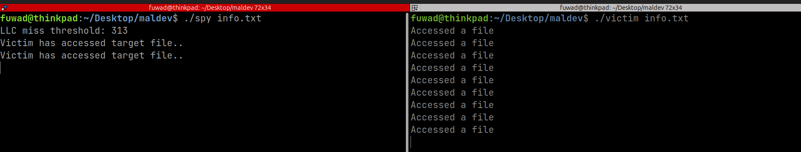
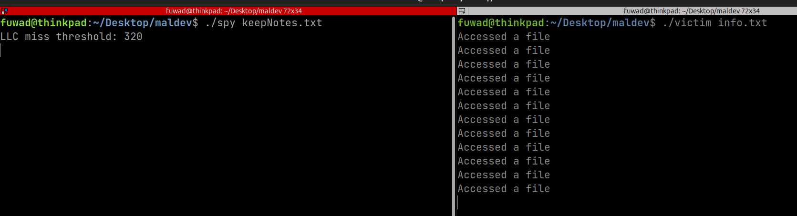

# Flush+Reload Cache Side-Channel Attack (PoC)

A working proof-of-concept implementation of the **Flush+Reload** cache side-channel attack on Intel x86, verified on Ubuntu 24.04 with an Intel Core i5 6th Gen (Skylake).

---

## What is Flush+Reload?

Flush+Reload is a cache-based side-channel attack first described by Yarom & Falkner (USENIX Security 2014). It exploits the shared Last Level Cache (LLC) between processes on the same physical machine.

The attack works in three steps:

1. **Flush** : The attacker evicts a target cache line using the `clflush` instruction
2. **Wait** : The attacker waits, giving the victim process a window to access the shared memory
3. **Reload** : The attacker reloads the cache line and measures access time using `rdtsc`/`rdtscp`

If the reload is **fast** (cache hit), the victim accessed that memory during the wait window.  
If the reload is **slow** (cache miss), the victim did not.

The prerequisite is **shared physical memory** between spy and victim. This PoC achieves that by having both processes `mmap()` the same file since neither process writes to it, the OS maps both to the same physical page-cache page.

---

## Environment

| | |
|---|---|
| CPU | Intel Core i5-6200U (Skylake, 6th Gen) |
| OS | Ubuntu 24.04 LTS |
| Compiler | GCC with `-O3 -march=native` |
| Kernel mitigations | Default Ubuntu 24.04 |

---

## Build

```bash
make
```

Or manually:

```bash
gcc -O3 -march=native -o spy spy.c
gcc -O3 -march=native -o victim victim.c
```

---

## Usage

### Same file (attack scenario)

Run spy and victim on the **same** file in separate terminals:

```bash
# Terminal 1
./spy target.txt

# Terminal 2
./victim target.txt
```

Expected output: spy detects victim's accesses roughly matching victim's 1-second sleep cadence:



### Different files (negative control)

Run spy and victim on **different** files:

```bash
# Terminal 1
./spy target.txt

# Terminal 2
./victim other.txt
```

Expected output: spy produces complete silence after the threshold line:



No false positives. This confirms the detection is tied to actual shared physical page access, not noise.

---

### `delay()` loop interfering with hardware prefetcher

The original spy loop used a cycle-counting delay between flush and reload:

```c
_mm_clflush(addr);
delay(100000);   // fixed ~30µs at 3GHz
maccess(addr);
```

The perfectly regular timing pattern (flush every N cycles, access every N cycles) was detectable by the hardware prefetcher, which speculatively brought the cache line back before the reload, making every reload appear as a cache hit. Replaced with `_mm_mfence()`, which serves two purposes: it guarantees `clflush` completes before the reload begins (ordering), and it removes the regular timing pattern the prefetcher was exploiting.

---

## How the Threshold is Computed

`flush_reload_threshold_detection()` runs 1,000,000 iterations each of:
- `reload_t()` : measures access time to a hot (cached) line
- `flush_reload_t()`: measures access time after a `clflush` (cold line)

The threshold is computed as a weighted average biased toward the cached access time:

```
threshold = (flush_reload_time + reload_time * 2) / 3
```

This places the threshold closer to the cache-hit side of the distribution, reducing false positives.

---

## Disclaimer

This code is for **educational purposes only**. It demonstrates a documented hardware security concept in a controlled, local environment. Only run this on systems you own or have explicit permission to test.

---

## References

- Yarom, Y. & Falkner, K. (2014). *FLUSH+RELOAD: A High Resolution, Low Noise, L3 Cache Side-Channel Attack*. USENIX Security Symposium.
- [taehunk/simpleFR](https://github.com/taehunk/simpleFR) — reference implementation studied during development
- [koreauniv-lsm/CSCA](https://github.com/koreauniv-lsm/CSCA) — reference implementation studied during development
- [IAIK/flush_flush](https://github.com/IAIK/flush_flush) — original `cacheutils.h` primitives that influenced both reference repos
